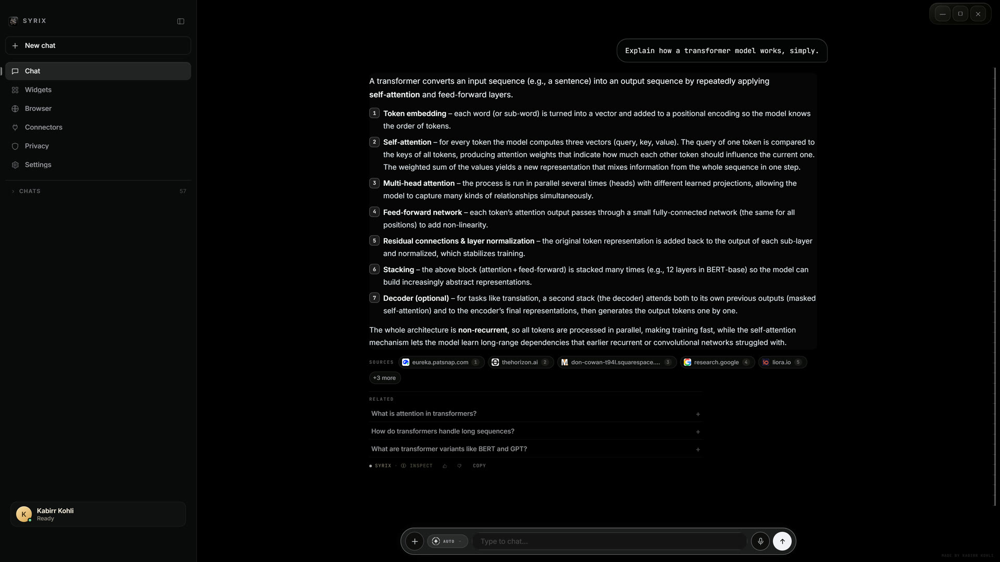

# SYRIX

A desktop AI assistant for Windows: a voice- and chat-driven agent that researches the live web, works with documents, connects to everyday services and can carry out multi-step tasks in its own sandboxed browser — with a written threat model and a permission system that keeps the person in control.



## What it does

- **Answers with evidence.** Every turn is triaged in code before any model is called. Questions that need current facts trigger a parallel search across several engines; the best pages are opened together and the answer is written from what they say, with sources attached.
- **Three modes.** *Spark* for fast answers, *Zenith* for deeper research with sub-agents, and *Auto*, which picks between them from the structure of the question rather than a keyword list.
- **Supercomputer mode.** A separate agent that plans and carries out longer tasks in its own browser — reading sites, filling forms, producing documents and spreadsheets — and stops for explicit approval before anything with an effect outside the machine.
- **Documents.** Reads PDFs (including scans, via OCR), Word, Excel, PowerPoint, OpenDocument, RTF and archives, and answers questions grounded in the file.
- **Connectors.** Twenty-seven services — including Gmail, Outlook, Google Calendar and Drive, GitHub, Notion, Slack, Jira and Spotify — each behind its own permission scope.
- **Desktop interface.** An Electron and React shell with chat, a voice mode, a live activity panel showing what the agent is doing, widgets and settings.

## Architecture

```
syrix_v3/            The assistant core: one turn pipeline for every mode
  turn.py            Entry point — resolve mode, build context, run the loop, return
  router.py          Chooses the mode for an Auto turn, once, before any model call
  loop.py            Agent loop with native tool calling and a fixed round budget
  check.py           Deterministic check that the reply actually answers the question
  lanes/             Model transport: races providers, reads their live rate limits
  research/          Triage, parallel gathering, ranking and site readers
  tools/             Calculator, page reader, document and memory tools
  memory/            Long-term facts, each with provenance and a date
syrix_supercomputer/ Task agent: planner, browser control, permission gate, sandbox
syrix_web/           The single door to the internet: URL policy, fetching, injection defence
syrix_connectors/    Third-party services, OAuth and an encrypted token vault
syrix_docintel/      Document detection, extraction, retrieval and grounding
syrix_core_v2/       Provider pool and the event and reply contracts the core kept
hud_electron/        Desktop interface (Electron main process and React renderer)
tests/               pytest suites for every package above
docs/                Threat model
```

**Model access.** The v3 transport races free-tier lanes on Groq, NVIDIA and OpenRouter, with a local model through Ollama as the floor, so the assistant keeps working when every cloud provider is limited or offline. It admits a request only when the provider's own reported limits say it has room, and streams the answer as it arrives. The earlier provider pool, kept as an alternative transport, adds Cerebras, Mistral and GitHub Models.

**Grounding.** The reply passes a deterministic check before it is shown: does it answer what was asked, does it state figures it has no source for, did it echo the question back. A failure triggers one targeted repair round, not a stack of rewriting passes.

## Security

The design is documented in [`docs/THREAT_MODEL.md`](docs/THREAT_MODEL.md), which lists its invariants, trust boundaries and its own confirmed gaps. In code:

- **Permission gate.** Every Supercomputer action passes nine ordered checks. Grants live in memory only, cover one action for one task, and are void on task end, mode exit or restart — there is no "always allow".
- **Network policy.** One validator for every URL, with a second layer that resolves the host and refuses private, loopback and metadata addresses, which a string check alone cannot catch (DNS rebinding).
- **Prompt-injection defence.** Page text reaches a model only as marked data. A page cannot grant a permission or widen a task, because no text path leads to either.
- **Sandboxed code execution.** Python written by the agent runs with no network, no environment secrets and no read access to the project or its state directory.
- **Secrets.** Connector tokens are stored encrypted with Windows DPAPI, with no plaintext fallback. Provider keys are read from a git-ignored `.env`, and log and audit lines pass through a central redaction filter.

## Tests

```
pip install -r requirements.txt
pytest tests
```

1,782 tests. The suites cover the turn pipeline, routing, the model lanes, research, the answer check, memory, the permission gate, the sandbox, the browser policy, injection handling, connectors and document intelligence. Network-dependent paths are stubbed; no test calls a paid service.

## Scope of this repository

This repository contains the assistant core, its security layers and the desktop interface. The host process that starts the runtime on Windows and owns the microphone and window lifecycle is not included, so the desktop app does not start from this repository alone. Configuration (`config.json`, `.env`) and personal data are kept out of version control; `.env.example` lists the keys the code reads.

## Development history

Developed in a private repository — 484 commits, May to October 2026 — and published here as a curated snapshot. The working history stays private because it contains local configuration from development.

---

© 2026 Kabirr Kohli. All rights reserved. Published for viewing; no licence is granted to copy, modify or redistribute.
