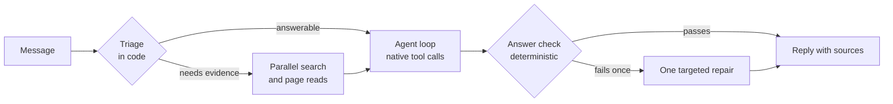

<p align="center">
  
</p>

<h1 align="center">SYRIX</h1>

<p align="center">
  <b>A desktop AI assistant for Windows that researches, works with documents and carries out tasks — with a threat model and a permission system that keep the person in control.</b>
</p>

<p align="center">
  Python · Electron · React · WebSockets<br>
  <a href="https://kabirr-kohli.pages.dev/syrix">Project page</a> ·
  <a href="https://kabirr-kohli.pages.dev">Portfolio</a>
</p>

<br>


## Why it exists

SYRIX is the assistant that runs on my own PC, and the project I have spent the longest on. It began in May 2026 as a voice assistant and grew into a full runtime. After an audit of my own code showed the old design had been built up in layers on top of problems rather than fixing them, I rebuilt the core from scratch as **v3**: one short turn pipeline, native tool calling, and checks that compare every answer against the question that was asked.

## Highlights

| | |
|---|---|
| **Answers with evidence** | Each turn is triaged in code before any model is called. Questions that need current facts trigger a parallel search across several engines; the best pages are opened together and the answer cites them |
| **Three modes** | *Spark* for fast answers, *Zenith* for deeper research with sub-agents, and *Auto*, which picks between them from the structure of the question |
| **Supercomputer mode** | A separate agent that plans and carries out longer tasks in its own browser — reading sites, filling forms, producing documents and spreadsheets — and stops for approval before anything with an effect |
| **Documents** | PDFs (including scans, via OCR), Word, Excel, PowerPoint, OpenDocument, RTF and archives, with answers grounded in the file |
| **Connectors** | Twenty-seven services, including Gmail, Outlook, Google Calendar and Drive, GitHub, Notion, Slack, Jira and Spotify, each behind its own permission scope |
| **Desktop interface** | An Electron and React shell with chat, voice mode, a live activity panel, widgets and settings |

## How a turn works



The mode is decided once, in code, before any model call, and then holds for the whole turn. The model lanes race free-tier providers (Groq, NVIDIA, OpenRouter) and admit a request only when the provider's own reported rate limits say it has room, with a local model through Ollama as the floor.

## Engineering notes

- **One decision, made early.** The previous runtime ran a deep engine *after* the fast one had already answered and shipped whichever finished first, so a fast turn paid a deep turn's latency. v3 routes once, up front, from the shape of the question rather than a keyword list.
- **Tools are native.** The old loop asked the model to write tool requests into its prose and parsed them back out, which is how tool markup reached the screen. v3 sends `tools` and reads `tool_calls`, the protocol every provider already speaks.
- **The answer is checked against the question.** A deterministic check — no model call — catches replies that echo the question, state figures with nothing behind them, or answer something else. A failure triggers one targeted repair, not a stack of rewriting passes.
- **The default is to gather.** An early version listed the cases that obviously needed evidence and searched nothing otherwise; asked about two products it had never heard of, it invented the comparison. Triage now gathers unless a question clearly needs no evidence.
- **Memory with provenance.** Every remembered fact records when it was learned and from what, so it can be judged, corrected and aged ("flying to Lisbon in March" becomes "went to Lisbon" once March passes).

## Security

The design is documented in [`docs/THREAT_MODEL.md`](docs/THREAT_MODEL.md) — invariants, trust boundaries and its own confirmed gaps. In code:

| | |
|---|---|
| **Permission gate** | Every Supercomputer action passes nine ordered checks: kill switch, known action, capability, task state, earlier refusal, task scope, permission, time budget, audit |
| **Grants** | In memory only, for one action in one task, void on task end, mode exit or restart. There is no "always allow" |
| **Network policy** | One validator for every URL, plus a second layer that resolves the host and refuses private, loopback and metadata addresses — the DNS-rebinding case a string check cannot catch |
| **Prompt injection** | Page text reaches a model only as marked data; no text path can grant a permission or widen a task |
| **Sandboxed code** | Python the agent writes runs with the network disabled, no secrets in its environment and no read access to the project |
| **Secrets** | Connector tokens encrypted with Windows DPAPI, with no plaintext fallback; provider keys in a git-ignored `.env`; logs pass a central redaction filter |

## Tests

```
pip install -r requirements.txt
pytest tests          # 1,782 tests
```

The suites cover the turn pipeline, routing, model lanes, research, the answer check, memory, the permission gate, the sandbox, browser policy, injection handling, connectors and document intelligence. Network-dependent paths are stubbed; no test calls a paid service.

## Repository layout

```
syrix_v3/            The assistant core: one turn pipeline for every mode
  turn.py · router.py · loop.py · check.py
  lanes/ · research/ · tools/ · memory/
syrix_supercomputer/ Task agent: planner, browser control, permission gate, sandbox
syrix_web/           The single door to the internet: URL policy, fetching, injection defence
syrix_connectors/    Third-party services, OAuth and an encrypted token vault
syrix_docintel/      Document detection, extraction, retrieval and grounding
syrix_core_v2/       Provider pool and the event and reply contracts the core kept
hud_electron/        Desktop interface (Electron main process and React renderer)
tests/               pytest suites for every package above
docs/                Threat model
```

## Scope

This repository holds the assistant core, its security layers and the desktop interface. The Windows host process that starts the runtime and owns the microphone and window lifecycle is not included, so the desktop app does not start from this repository alone. `.env.example` lists the keys the code reads.

## Development history

Developed in a private repository — 484 commits, May to October 2026 — and published here as a curated snapshot. The working history stays private because it contains local configuration from development.

---

<p align="center"><sub>© 2026 Kabirr Kohli. All rights reserved. Published for viewing; no licence is granted to copy, modify or redistribute.</sub></p>
